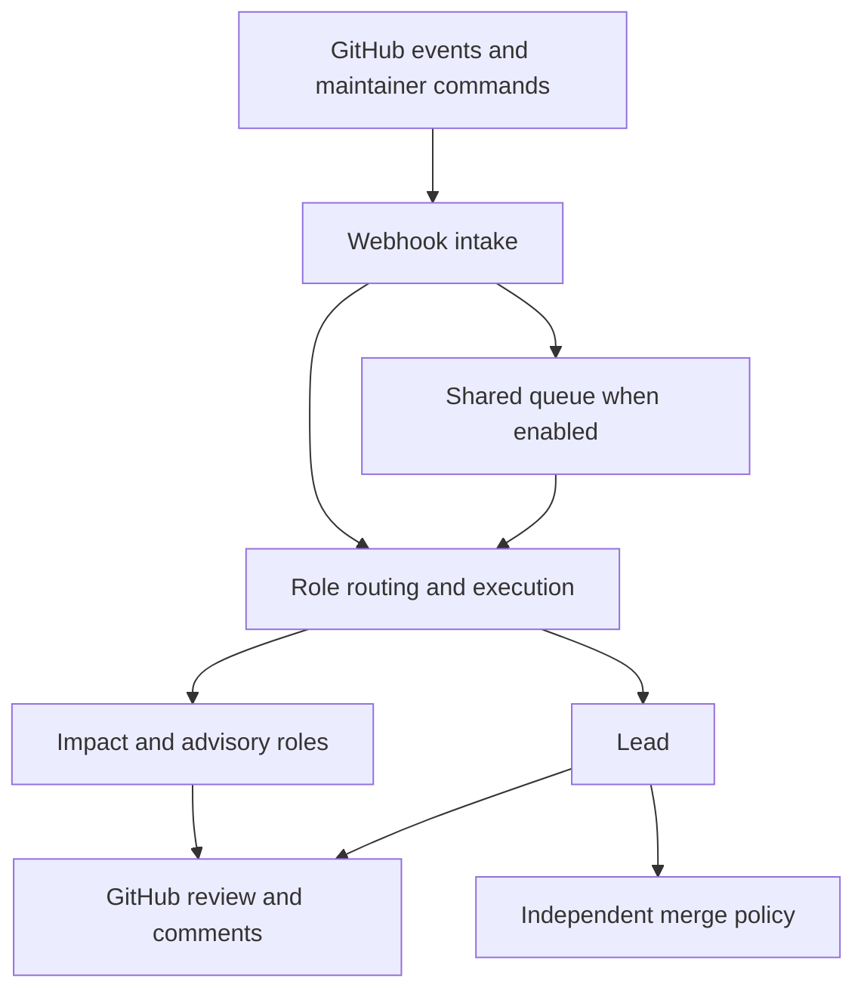

# Oddmash AI

Oddmash AI is the unified development repository for the Oddmash Skills catalog and Agents runtime. Both share source history and CI while retaining independent installation, runtime adoption and release lifecycles.

| Component | Location | Getting started |
| --- | --- | --- |
| Skills | `catalog/` | [Catalog](catalog/README.md), [installation](catalog/CONTRIBUTING.md), [distribution](catalog/DISTRIBUTION.md) |
| Agents | `apps/`, `packages/`, `api/` | [Development](CONTRIBUTING.md), [agent family](docs/agent-family.md), [release process](docs/release-process.md) |

## Current status

The source integration and CI are complete. Production still runs from the original [Oddmash Agents repository](https://github.com/Oddmash/oddmash-agents), and existing [Skills installations](https://github.com/Oddmash/oddmash-skills) remain supported during the transition. Production qualification and reviewer enrollment in this repository are paused pending maintainer configuration and authorization. See [migration status](docs/unified-source-migration.md), [cutover checklist](docs/unified-cutover-checklist.md) and [the open cutover issue](https://github.com/Oddmash/oddmash-ai/issues/11).

## Install Skills independently

From a stable checkout of this repository, use Python 3.9 or later:

```sh
python3 catalog/scripts/install.py --validate
python3 catalog/scripts/install.py --check
python3 catalog/scripts/install.py
```

No Node.js, agent credentials or hosted service is required. The installer preserves existing installations; follow the [migration guide](docs/unified-source-migration.md#independent-catalog-installation) before replacing legacy links.

## Oddmash Agents

Advisory agents for Oddmash products. Lead coordinates specialized agents, identifies concrete regressions in pull requests, and issues the formal review while preserving project-specific conventions and maintainer control.

## Getting started

Oddmash Agents is open-source software used to review eligible pull requests in Oddmash's enrolled repositories. The hosted GitHub Apps are operated by Oddmash; a public, self-service installation into arbitrary repositories is not a supported or verified offering. Do not install an app or request repository permissions solely to try the agents.

- **Contributing to Oddmash:** Open a pull request in an eligible Oddmash repository and wait for its required checks. Read the Lead review and any specialist findings in the PR conversation and Files changed. If no review appears, check CI and ask the maintainer; slash commands are maintainer-controlled.
- **Exploring the project:** Read [public onboarding](docs/public-onboarding.md), [the agent family overview](docs/agent-family.md) and [contributing](CONTRIBUTING.md). The offline test suite is the first-use path for developers inspecting the source without any credentials or external calls.

Example of advisory feedback (illustrative, not a real PR): a UI change removes keyboard focus feedback. Lead reports the affected line and asks for restored focus visibility; QA can describe missing keyboard coverage. The maintainer decides how to address the findings and whether to merge.

The operator console is private. A public source repository or GitHub App profile does not grant access to it.

## Agent family

| | Agent | Responsibility | Execution | Command |
| --- | --- | --- | --- | --- |
|  | Oddmash Lead | Coordination, concrete defects and final review | Automatic | `/review` |
|  | Oddmash Impact | Product value, necessity and trade-offs | On request | `/impact` |
|  | Oddmash Triage | Issue classification, duplicates and priority | On request | `/triage` |
|  | Oddmash QA | Missing tests and observed verification | On request | `/qa` |
|  | Oddmash Release | Changelog and release note drafts | On request | `/release` |
|  | Oddmash Docs | Code and documentation consistency | On request | `/docs` |
|  | Oddmash Architect | Design and maintainability assessment | On request | `/architect` |

Lead is the only automatic entry point (currently authenticated as `oddmash-lead[bot]`). Other roles respond to explicit maintainer slash commands and produce advisory output. With optional coordinated review enabled, Lead selects only relevant PR advisors from changed-file metadata within explicit request and time budgets. These reports do not grant approval or merge authority. They share the same server and queue, while role-specific identity, permissions and model usage remain separately configurable. Use `/review` for the formal review and the [slash command table](docs/agent-family.md#slash-commands) for specialist requests. Dedicated apps must be enabled and installed for specialist responses.

See [agent family and setup](docs/agent-family.md) for invocation details and role configuration. The owner-only console can restrict optional coordinated runs through [operator runtime controls](docs/operator-runtime-controls.md).

## Lead

Lead coordinates specialized advisors and owns formal review decisions. It independently checks concrete defects and mandatory requirements; optional specialist improvements do not become duplicate Lead findings. See [the identity and attribution guide](docs/lead-identity.md).

Automatic reviews wait for required CI and submit one initial review per pull request. A subsequent push does not trigger another full review: older review evidence is stale for the current head. An authorized maintainer may request fresh full review using `/review`; scoped review-thread replies remain available. Approval and automatic merge always require exact-current-head evidence. Public PR review output is English only.

Set `REVIEWER_AUTO_ADVISORY_ENABLED=true` to enable selective additional advisor reports per automatically reviewed head. `REVIEWER_AUTO_ADVISORY_MAX_REQUESTS` bounds attempts (default and hard maximum 5; 0 disables), and `REVIEWER_AUTO_ADVISORY_MAX_MS` bounds the advisory stage (default 90,000 ms, hard maximum 120,000 ms; 0 disables). Small documentation edits and operational or sensitive paths do not trigger coordinated advisors; exact-head and existing file filtering remain in effect. These budgets limit request count and elapsed time, not exact monetary charges. Each enabled dedicated advisor publishes under its own GitHub App identity using its existing repository-scoped installation and per-role model configuration. Unavailable or unauthorized roles are skipped; automatic advice never falls back to the Reviewer account. Triage remains issue-only. No advisor can invoke another advisor. Existing head and role markers prevent duplicate reports, and runtime logs contain role outcomes rather than source or credentials.

- Analyzes open PRs in public and explicitly approved private repositories using GitHub's changed-file and check APIs.
- Uses organization and trusted base-branch root and nested `AGENTS.md` guidance.
- Produces English, evidence-linked, severity-ranked reports and optional inline GitHub Suggested changes; posting is explicitly enabled and deduplicated per finding and commit. Private reviews keep stricter data exclusions, use repository-scoped authentication, and remain subject to separate merge eligibility.
- Never checks out or executes contributor code or modifies source. The advisory reviewer never merges. An independently gated maintainer-only merge module can merge eligible low-risk changes after issue verification, current CI and review approval.

Oddmash operates a maintainer-configured organization GitHub App that can approve fully reviewed changes with passing checks or request changes for high-confidence findings. Independent deployments remain report-only until explicitly configured. Private repository enrollment requires separate maintainer approval, and approved private repositories can use the same separately gated merge policy for eligible low-risk changes.

See [CONTRIBUTING.md](CONTRIBUTING.md) for setup and [the rollout plan](docs/rollout.md) for the activation checklist.

Optional authenticated organization guidance reads are default-off. See [shared guidance setup and troubleshooting](docs/shared-guidance.md) for the activation prerequisites, conditional HTTP 304 behavior and stale-cache denial.

## Architecture

Use a single modular serverless application, shared queue and independently configured agent roles. Keep advisory execution separate from approval and merge policy. Shared skills provide guidance, not execution permissions.



The local CLI and organization workflow also use the review engine. Queue-backed execution is optional; neither path replaces repository checks or release policy.

| Component | Responsibility |
| --- | --- |
| [Webhook intake](api/github.ts) and [queue worker](api/review-jobs.ts) | Receive eligible events and coordinate review jobs. |
| [Review orchestration](apps/worker/src/webhook-review.ts) | Coordinate evidence, progress and publication. |
| [Review engine](apps/worker/src/reviewer.ts) and [review model](apps/worker/src/core.ts) | Collect bounded evidence, validate findings and classify outcomes. |
| [Product context](apps/worker/src/review-context.ts) and [CI evidence](apps/worker/src/checks.ts) | Supply project-specific quality criteria and current check results. |
| [Discussion](apps/worker/src/review-discussion.ts), [Impact](apps/worker/src/impact.ts) and [advisory engine](apps/worker/src/advisory.ts) | Support evidence-based follow-up and on-demand role assessments. |
| [Merge policy](apps/worker/src/auto-merge.ts) | Independently verify eligibility before any authorized merge. |
| [Evaluation](apps/worker/src/evaluation.ts) and [offline tests](tests/) | Measure finding accuracy and protect behavior with deterministic fixtures. |

### Evolution

Role-aware execution events and per-role model budgets use the existing runtime logs and a small shared serialization and usage module. See [agent operations](docs/agent-operations.md) for monitoring, limits and cost estimation. Each role retains its own evidence and output validation contract rather than sharing a generalized execution framework.

The operator console is implemented in the same workspace and served from the existing Vercel project. See [operator workspace](docs/operator-workspace.md) for configuration and activation requirements. Keep cross-agent collaboration explicit and maintainer-directed. Split servers or queues only when measured load, reliability or isolation needs justify the operational cost.

### Development and release

Implement changes on focused branches from `main` and open pull requests directly against `main`. Merge only after current-head CI and review; this repository does not use a `develop` integration branch. Production releases are separate from advisory review. Guarded auto-merge may target `develop` or the default `main` branch only when the existing repository, maintainer, acceptance, low-risk, exact-head CI and branch-protection requirements are satisfied. Incomplete review coverage does not constitute approval.

See [review quality](docs/review-quality.md), [evaluation baseline](docs/evaluation-baseline.md) and [rollout](docs/rollout.md) for operational details.

## Shared guidance

The [Skills catalog](catalog/README.md) owns reusable work methods. The agent workspace owns executable agents and operational controls. See the [skill integration contract](docs/skill-integration.md) for the approved reference, upgrade procedure, and boundaries.
